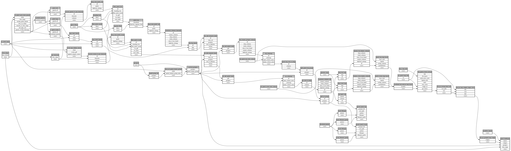

```
# AUTOGENERATED BY ECOSCOPE-WORKFLOWS; see fingerprint in README.md for details

```

```yaml
# fingerprint:
artifacts_sha256_basic: 9a71abb8115309b62026ea7e6c4e6ea4171d19e027ffc101bc3e680b76ebff25
artifacts_sha256_strict: 0082f134298e1dccf7df9c91736dcb3c4696a5c7352c4a5939776ea5c498484f
installed_requirements:
- channel: https://repo.prefix.dev/ecoscope-workflows/
  name: ecoscope-platform
  version: {version: ==2.27.1}
- channel: conda-forge
  name: pydeck
  version: {version: ==0.9.2}
params_sha256: 563197e756a98dfeb72ee958bd2c9966d8989e9ba25c37537b79de1d84836996
spec_sha256: a194ab1f9ea095584fac694c13f932ad09ed1ed087dc65c3b925ade6d4418d57

```

# ecoscope-workflows-download-patrols-workflow


