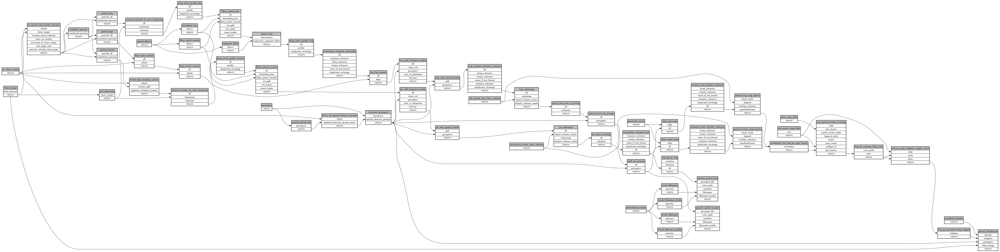

```
# AUTOGENERATED BY ECOSCOPE-WORKFLOWS; see fingerprint in README.md for details

```

```yaml
# fingerprint:
artifacts_sha256_basic: 5e6cb4bfb60290e4b58d49fdba756c58b16f9d081d66501a534beb5ad220e7bd
artifacts_sha256_strict: 683513dc978e27daf2b30486414d7e89a390d86faa81e6af64b165980988d517
installed_requirements:
- channel: https://repo.prefix.dev/ecoscope-workflows/
  name: ecoscope-platform
  version: {version: ==2.28.0}
- channel: conda-forge
  name: pydeck
  version: {version: ==0.9.2}
params_sha256: 563197e756a98dfeb72ee958bd2c9966d8989e9ba25c37537b79de1d84836996
spec_sha256: 631d90628ca3089c6b741243065e734c17934ef83d06df283f3f66f373fd0d0d

```

# ecoscope-workflows-download-patrols-workflow


